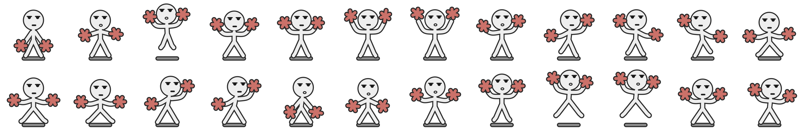

<p align="center"></p>

# CheerUp

一个停在屏幕角落的 macOS 盯盘小窗，支持 A 股、港股、美股。面板上站着一个会跳舞的拉拉队员，收起后只剩它。

A tiny floating stock ticker for macOS (China A-shares, Hong Kong, US). A cheerleader stands on top of the panel; minimised, only the cheerleader stays.

<p align="center"></p>

## 它能做什么

- **看行情**：自选股的现价和涨跌幅，A 股、港股、美股各一页。
- **看详情**：点一行展开当日分时走势、成交量、今日区间和几个常用数字。走势图可以双指捏合或滑动放大。
- **不打扰**：只占屏幕一角，没有 Dock 图标。想让它平时淡一点，把配置里的 `opacity` 调小。想让它不出现在截图和屏幕共享里，把配置里的 `hideFromScreenShare` 改成 `true`（鼠标停在上面时仍能截到）。
- **拉拉队**：一个小人站在面板上沿，点它收起或展开面板。开盘时跳一套动作，休市时睡觉，鼠标靠近会看着你；花球跟随市场配色时，切换市场它会背过手去换一副。
- **中文 / English**：第一次打开时选语言。

## 安装

需要 macOS 12 或更高版本，以及 Xcode 命令行工具（`xcode-select --install`）。

```bash
git clone https://github.com/OkraBing/cheerup.git
cd cheerup
bash build.sh
open CheerUp.app
```

程序没有苹果的开发者签名。如果是别人编译好发给你的，第一次打开要右键点它 →「打开」。

## 使用

| 操作 | 做什么 |
|---|---|
| 点右上角的 `+` | 按名称、拼音首字母或代码搜索并添加 |
| 点一行 | 展开详情；再点一次收起 |
| 拖动市场标签 | 调整 A 股 / 港股 / 美股的顺序 |
| 右键市场标签 | 移除这个市场（连同里面的股票，会再确认一次） |
| 鼠标停在拉拉队身上 | 它旁边冒出一个气泡：让它休息（按 `R`）/ 加油（按 `C`），或退出 |
| 展开后按 `↑` `↓` | 换上一只 / 下一只；`Esc` 收起 |
| 右键一行 | 移除，或移到最前 |
| 按住一行上下拖 | 调整顺序 |
| 在走势图上捏合、滑动或双击 | 放大某个时段；也可以按 `=` `-` `←` `→` `0` |
| `⌃⌥S` | 隐藏 / 显示 |
| 点顶部栏的小窗图标 | 隐藏 / 显示 |

设置里可以改拉拉队的大小、花球配色、作息跟随哪个市场、展开面板时它还站不站在上面（关掉后展开只有面板，标题条多一个「隐藏」按钮；收起后仍然是它），以及界面大小（小 / 中 / 大 / 特大，文字和间距一起等比放大）、语言和登录时打开。

## 配置文件

`~/.cheerup/config.json`，改完保存，几秒内生效。

| 项 | 含义 |
|---|---|
| `stocks` | 自选股代码。`600519` 是 A 股，`hk00700` 是港股，`usAAPL` 是美股；指数如 `sh000001`、`hkHSI`、`us.IXIC` |
| `aliases` | 给某只起别名，例如 `{"600519": "MT"}` |
| `opacity` | 平时的透明度，0.08–1 |
| `refreshSeconds` | 刷新间隔，最小 2 秒 |
| `theme` | `dark` / `light` / `none` |

## 数据来源与免责声明

行情和搜索来自腾讯证券的公开接口，分时走势在它取不到时改用东方财富。这些都不是官方授权的数据服务，可能延迟、出错或随时不可用。

本软件仅供个人学习和娱乐，不构成任何投资建议。

## 开发

全部代码在 `main.swift` 一个文件里，没有第三方依赖。

```bash
bash build.sh                                        # 编译
./CheerUp.app/Contents/MacOS/CheerUp --selftest      # 自检
swift make_icon.swift . && iconutil -c icns CheerUp.iconset -o icon.icns   # 重新生成图标
```

## 许可

[MIT](LICENSE)
